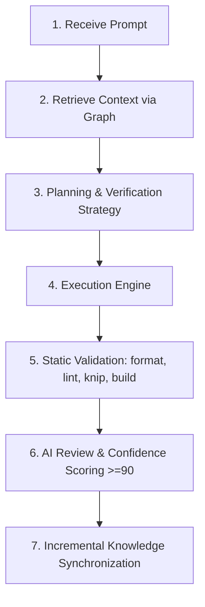

# Workflow Specification — Execution Lifecycle

## Deterministic Execution Pipeline
Every user prompt must follow the sequential lifecycle:

## Constraints
- No stage may be skipped.
- If static validation fails, execution returns directly to the coding phase without AI review.
- No implementation logic exists inside this file.
